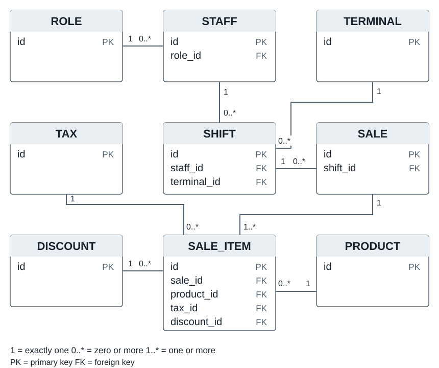

# MIT 8103 Advanced Database Systems: Portfolio Summary

**Author:** Chigoziem Edmund Ofili (301917477) 
**Case study:** Retail POS and Inventory System 
**Repository:** https://github.com/Edmund0/advanced-database-portfolio

## Case study

GoodNaija, a growing supermarket in downtown Lagos, is in need of a point-of-sale (POS) and inventory tracking system. The supermarket has two main checkout terminals, two cashiers, and one supervisor. The cashiers can open and close their shifts, record sales and giveaways, and accept cash, card or transfer payments. The supervisors maintain staff, products, prices, and receive stocks. The design excludes refunds, partial payments, user authentication and card processing.

## Portfolio 1: Database Design and Modelling

GoodNaija's PostgreSQL database system was designed around its normal daily operations: opening and closing till shifts for staff, recording sales and giveaways, and keeping track of inventory. The design has nine tables: `role`, `staff`, `terminal`, `shift`, `product`, `sale`, `sale_item`, `tax` and `discount`. The [ER diagrams](portfolio-1-database-design/design/ERDiagram.md) shows the attributes, keys, and relations of the nine tables.

**Normalization**: In order to minimize data redundancies and maintain data integrity, the database schema was designed to satisfy the requirements of the first, second, and third normal forms (1NF, 2NF, and 3NF). The [normalization examples](portfolio-1-database-design/design/Normalisation.md) demonstrates the process used to develop the final schema. In the example, we started off with a receipt record that contained all its relevant information.

In the normalization example:

- **1NF**: The 1NF requires all fields to be **atomic**. The receipt's items column had a list of purchased items. To fix this, each item had to become a separate sales-item row. 
- **2NF**: The 2NF requires non-key fields to depend on the whole of all possible candidate keys. A `sales item` was identified by `receipt number` and `product SKU`. However, `receipt details` depended only on `receipt number`, while `product names` depended only on the `product SKU`. To fix this, products was moved to a separate table. 
- **3NF**: A sale identified a shift, while a shift identifid a cashier and terminal. To remove **transitive dependencies**, the details of staff, role, terminal, and shift were moved to their own tables. 

**Keys and Constraints**: Primary keys identify each record, while foreign keys connect records that belong together, such as a sale item and its product. The database also uses unique constraints to prevent duplicate receipt numbers and check constraints to prevent negative stock [1]. A unique index ensures that a terminal can only have one open shift at a time.

**Tests**: The database was tested by trying to add records that broke five rules: negative stock, two open shifts on one terminal, both paid and giveaway quantities set to zero, a giveaway without a reason, and the same product twice on a receipt. Two further tests checked that a valid sale could be saved and that changing tax and discount rates left past receipts unchanged.

**Results**: The [tests](portfolio-1-database-design/sql/Test.md) showed that:

- All five invalid inserts failed because they violated the database constraints. 
- After a sale of 2 paid units of Beans and 1 giveaway was saved. Stock fell from 50 to 47 because all 3 units left inventory, but only the 2 paid units were charged, giving a total revenue of 1000.
- Changing the current tax rate and discount rate did not change the rates saved on the existing sale items.

*Figure 1. The nine database tables, their keys and relationships.*

## Portfolio 2: Query Processing and Optimisation

In the second portfolio, SQL queries were written to generate reports for the supermarket. One query, Q2, was selected to demonstrate the benefits of query optimization techniques, such as indexing. Q2 was tested before and after adding an index on the sales date to see whether the index reduced its execution time.

**Query Test**: Four SQL queries were written to show receipt details, revenue for a selected period, revenue by payment method, and products running low on stock. They were tested against the database from Portfolio 1 to confirm that they returned the expected results. The period revenue query (Q2) successfully returned 4400.00 excluding tax and a giveaway value of 1500.00.

**Optimization Test**: Q2 calculates total revenue by searching for sales within a selected period and adding up the values of their sales item. An index was added to the sale date column to help PostgreSQL find those sales faster. The test compared Q2's execution time and the steps PostgreSQL used to return the result, using `EXPLAIN ANALYZE` with `BUFFERS` [2].

The first optimization test used the much smaller database from Portfolio 1. The second test used a separate benchmark database containing 10,000 sales and 20,000 sale items. Both test consisted of a warm-up and 3 timed runs before and after adding the index. The median execution time were from each set of three runs were compared. 

| Database | Before index | After index |
| --- | --- | --- |
| Portfolio 1: median execution time | 0.040 ms | 0.047 ms |
| Benchmark: median execution time | 5.434 ms | 1.798 ms |

**Results**: On the small Portfolio 1 database, PostgreSQL checked every sale both before and after the index was added. PostgreSQL's query planner selects the fastest method to complete a query. Because the database was small, the planer choose to scan the table rather than use the index. The index was not used and gave no measured improvement.

On the benchmark database, PostgreSQL used the index on the sale date column to find 100 matching sales, then used the existing sale-item index to retrieve their 200 items. Q2 was 3 times faster with the index. 

## Portfolio 3: Transactions and Concurrency

The third portfolio demonstrated how transactions save/commit and undo/rollback changes and how the database handles two cashiers trying to open a shift on the same terminal.

**Transaction Test**: The first transaction test closed a shift and saved it using `COMMIT`. The second transaction test opened up another shift, attempted to close it with an invalid closing time which caused an error, and rolled back the changes using `ROLLBACK`.

**Concurrency Test**: For the concurrency test, two database sessions represented two cashiers trying to open a shift on the same terminal. Both sessions used `READ COMMITTED`, which allowed a session to read only committed changes from other transactions [3]. Session A opened a shift but did not save/commit it. Session B queried the database to first confirm that the terminal was free to open up a shift. After finding no shifts on the terminal, B tried to open up another shift on the same terminal. While B waited for a response, A committed its shift which caused B's request to fail because the unique index allows only one open shift per terminal. B's response and the final saved shift were then checked.

**Results**: The [tests](portfolio-3-transactions-concurrency/sql/Test.md) showed that:

- `COMMIT` saved the first shift's closing time. `ROLLBACK` removed the new shift after the invalid closing time was rejected, while the earlier committed change remained.
- Session B could not see A's uncommitted shift. Session B's attempt to open the terminal had to wait until A committed. A committed which caused B's insert to fail. Only A's shift was saved.

## Portfolio 4: NoSQL and Advanced Data Models

In the fourth portfolio, a document database based on MongoDB was designed as an alternative to the PostgreSQL database. Instead of relational data records, information were recorded as events stored in MongoDB using the pos_events database and inventory_events collection. 

**Document Model**: An event can either be a delivery (stock increase), a sale, or a giveaway. Each event was stored as a document. The product and staff detail associated with that event was recorded within the document. Other details stored in the document depended on the type of event. 

**Test**: Using MongoDB 8.0.34 and mongosh 2.14.1 in Codespaces, a database was created and [tests](portfolio-4-nosql/db/Test.md) were conducted to demonstrate the viability of the design:

- Four events were created and inserted which increased the document count from 0 to 4.
- Queries successfully returned the deliveries, sales and giveaways for Rice, and found a giveaway using its reason.
- The quantity changes were added together for each product [4]. Rice increased by 7 units and Soap by 5 units across the recorded events.

Unlike PostgreSQL, the document model keeps the details of an event together. However, it does not automatically enforces the business rules and constraints.

## Portfolio 5: Distributed and Cloud Database Exercise

For the fifth portfolio, a cloud database solution was proposed for GoodNaija's POS and inventory system. The [proposal](portfolio-5-distributed-cloud/ofili_chigoziem_301917477_P5_README.md) explained how the supermarket could process sales without having to maintain their own database server in the store,

**Deployment Model**: The two checkout terminals would connect to a remote PostgreSQL database system hosted in the Cloud. It would consist of two databases, a primary and a stanby. The standby would retain a copy of the database in another availability zone. If the primary failed, the standby would take over. [5]. If the need arise to switch server, there may be a temporary service disruption, and the old primary would need to stop accepting changes to prevent conflicting records.

**Data Replication and Backups**: Synchronous replication would ensure that both servers remain in sync. The primary server would require an acknowledgment from the standby before committing a transaction. This would ensure data integrity and consistency, but the drawback of this arrangement is that is increased latency and service disruption should the standby server fail to respond.

**Availability and Consistency**: The proposal favours protecting the records over continuing to accept sales without the required standby confirmation. This reflects the CAP trade-off: during a network partition, a distributed system cannot guarantee both consistency and availability at the same time.

**Security and Performance**: Access to the database would require authentication and role permissions, and connections would be encrypted. Since the checkout terminals would depend on an internet connection, transaction speed would need testing and a connection failure could prevent sales from being recorded.

**Scalability**: If the supermarket needed more capacity, the server's processing power, memory or storage could be increased. Sharding would split records across servers, but this would add complexity that the current single-store system does not need.

## Evidence

The repository contains the scripts, screenshots and detailed test records: [P1](https://github.com/Edmund0/advanced-database-portfolio/blob/main/portfolio-1-database-design/sql/Test.md), [P2](https://github.com/Edmund0/advanced-database-portfolio/blob/main/portfolio-2-query-optimisation/sql/Test.md), [P3](https://github.com/Edmund0/advanced-database-portfolio/blob/main/portfolio-3-transactions-concurrency/sql/Test.md), and [P4](https://github.com/Edmund0/advanced-database-portfolio/blob/main/portfolio-4-nosql/db/Test.md). [P5](https://github.com/Edmund0/advanced-database-portfolio/blob/main/portfolio-5-distributed-cloud/ofili_chigoziem_301917477_P5_README.md) contains the proposed deployment discussion. The separate practice databases keep the transaction and concurrency exercises distinct from the original POS query results.

## Individual reflection

**Design Choice**: In my original design, I initially recorded paid items and giveaway items on separate rows. However, this repeated the prices when the same product was both sold and given away on the same sale. The clearly violated 3NF requirement. In order to avoid an awkward arrangment where a separate table would be created, I instead update the design to store the quantities in their own columns. This allowed them to share one saved price while still recording how many units were paid for and how many were given away.

**Challenges**: Adding an index did not automatically improve the query's execution time. My first test was on a small database which showed no improvement. I later tested the same query on a much larger database, where PostgreSQL used the index and the query ran faster. Comparing both results helped me understand why an index should be tested rather than assumed to improve performance.

During the concurrency test, the first attempt to check the other session's activity returned no rows. The first query could not find Session B under its expected name. Making session naming a separate pre-setup step ensured it was done before the test. I separated the session setup into A0 and B0 and repeated the test. This time, the output showed Session B waiting for a lock before Session A committed. 

**Lessons Learned**: Checking whether a terminal has an open shift is not enough to prevent two cashiers from trying to open it. One session may not see another's uncommitted shift. The unique index was needed to prevent both shifts from being saved. This showed me why the database must enforce important rules even when a query appears to confirm that an operation is allowed.

## References

[1] PostgreSQL. [Constraints](https://www.postgresql.org/docs/16/ddl-constraints.html).

[2] PostgreSQL. [Using EXPLAIN](https://www.postgresql.org/docs/16/using-explain.html).

[3] PostgreSQL. [Transaction isolation](https://www.postgresql.org/docs/16/transaction-iso.html).

[4] MongoDB. [Aggregation with $sum](https://www.mongodb.com/docs/manual/reference/operator/aggregation/sum/).

[5] PostgreSQL. [Standby servers and replication](https://www.postgresql.org/docs/16/warm-standby.html).

