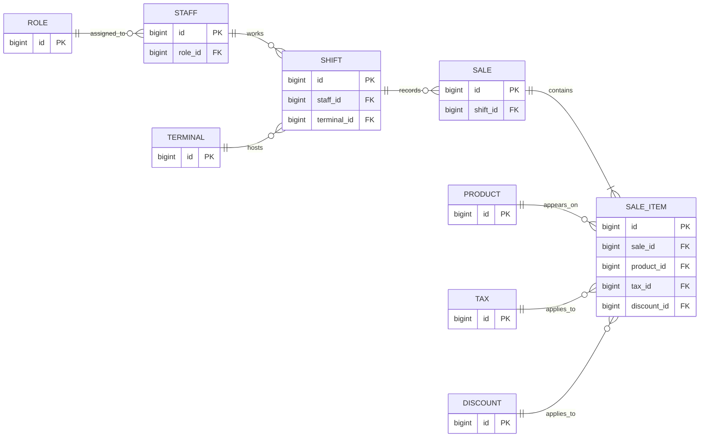
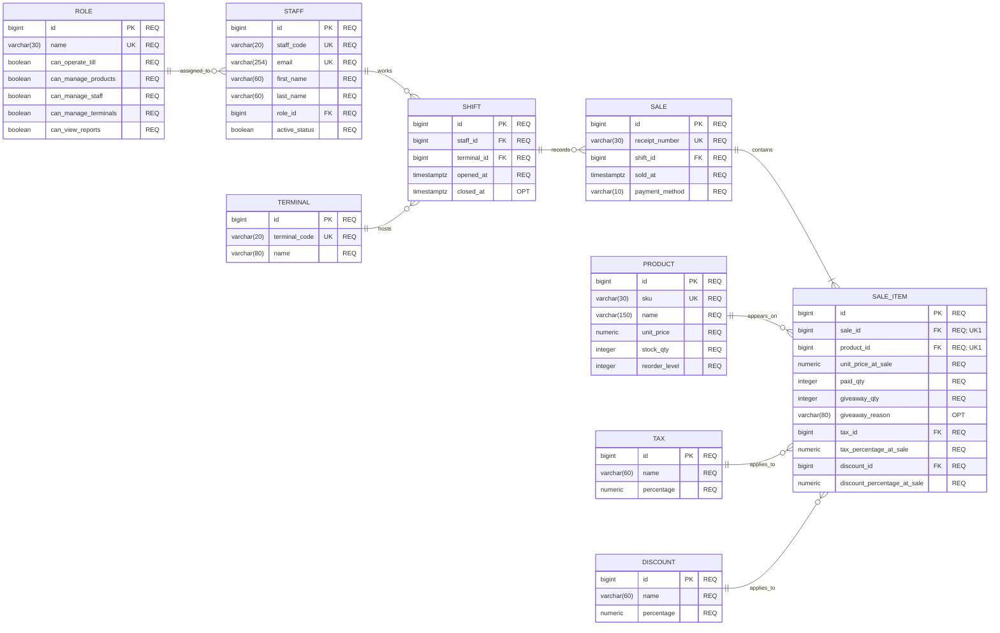

# Retail POS and Inventory System ER Diagram

Author: Chigoziem Edmund Ofili (301917477)

## Glossary

- **PK (primary key):** identifies each record and is unique.
- **FK (foreign key):** links to a record in another table.
- **UK (unique key):** values cannot repeat.
- **REQ (required):** required; cannot be NULL.
- **OPT (optional):** optional; may be NULL.
- **UK1:** sale_item.sale_id and product_id are unique together, not individually.

PK, FK and UK markers can be combined.

## Keys and relationships

## Full tables

See [Design.md](Design.md) for the attribute requirements and constraints.

**UK1:** In `sale_item`, `(sale_id, product_id)` is unique; neither column is unique on its own.
