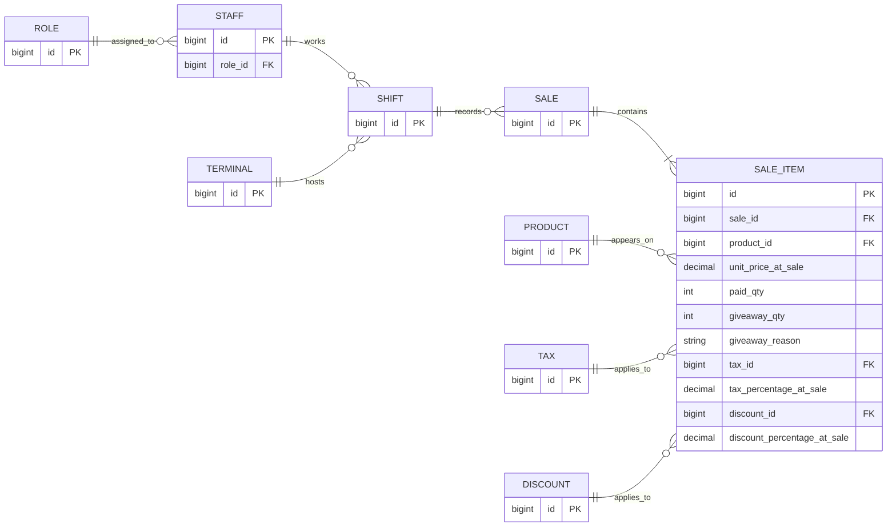

# Retail POS and Inventory System ER Diagram

Author: Chigoziem Edmund Ofili (301917477)

The basic entities and current relationships are shown below.

## Diagram

Each staff member has one role. The diagram shows selected fields; the full attribute list is in [Design.md](Design.md).

## Keys and symbols

| Key or relationship symbol used | Meaning | Example from this design |
| --- | --- | --- |
| [Key or symbol] | [Explain in plain words] | [Your example] |

## Optional fields

- 

## Rules beyond the diagram

- 

## Review

- 